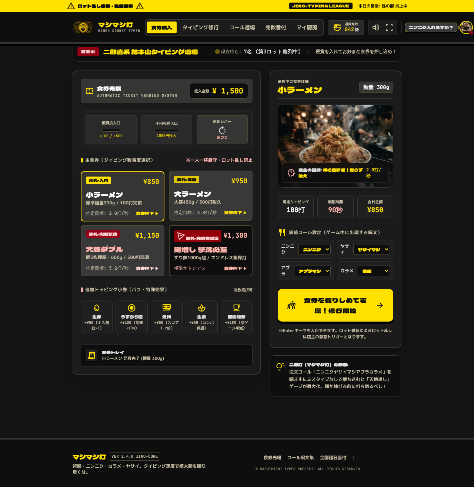
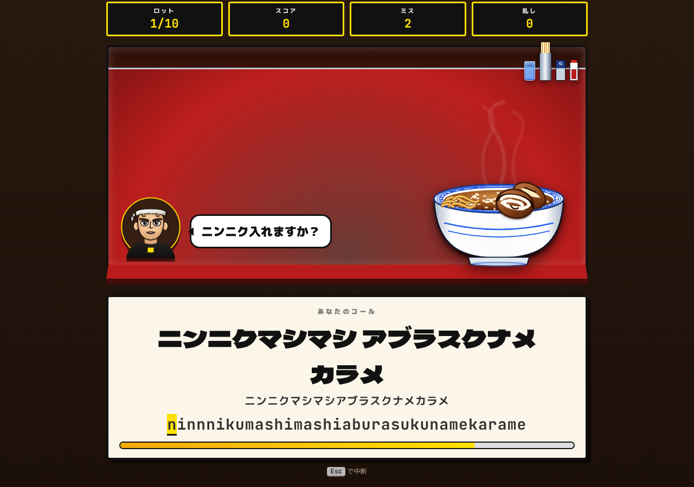
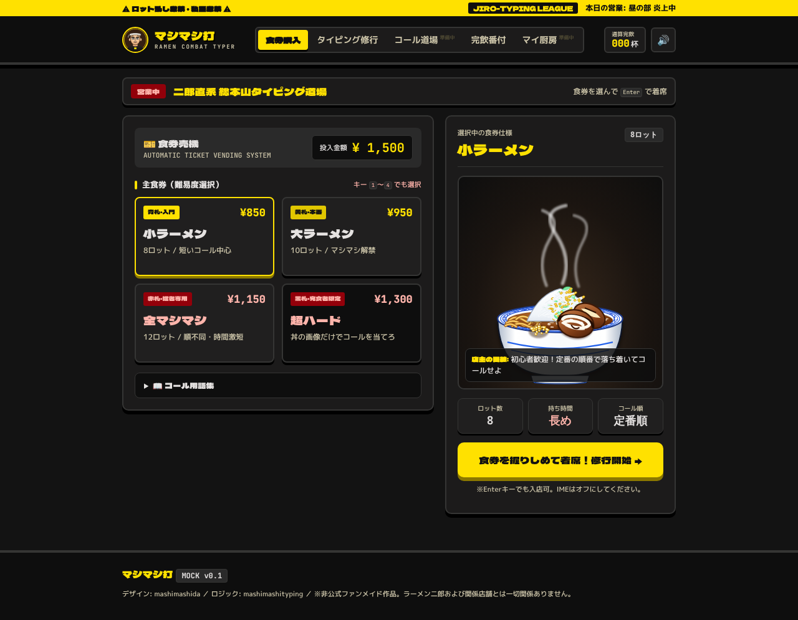
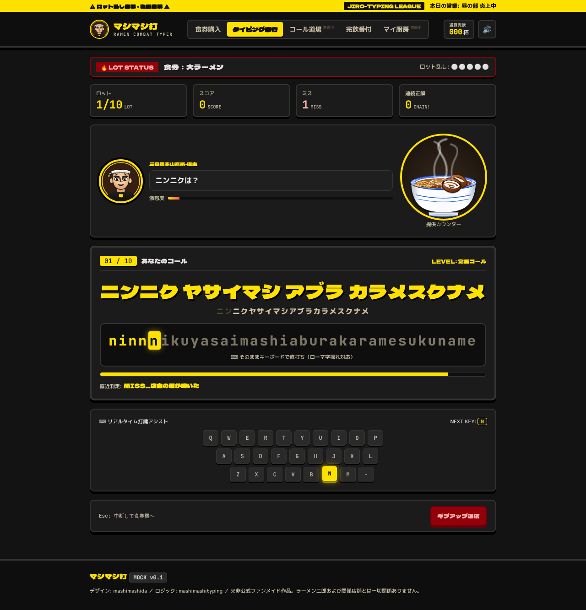
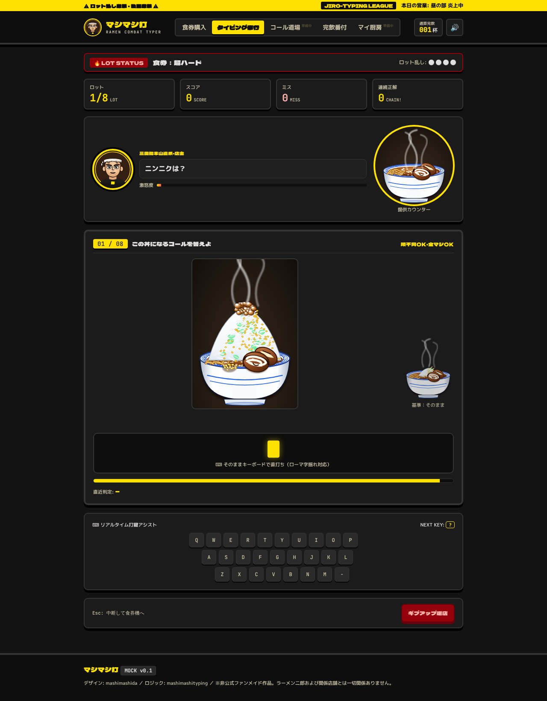
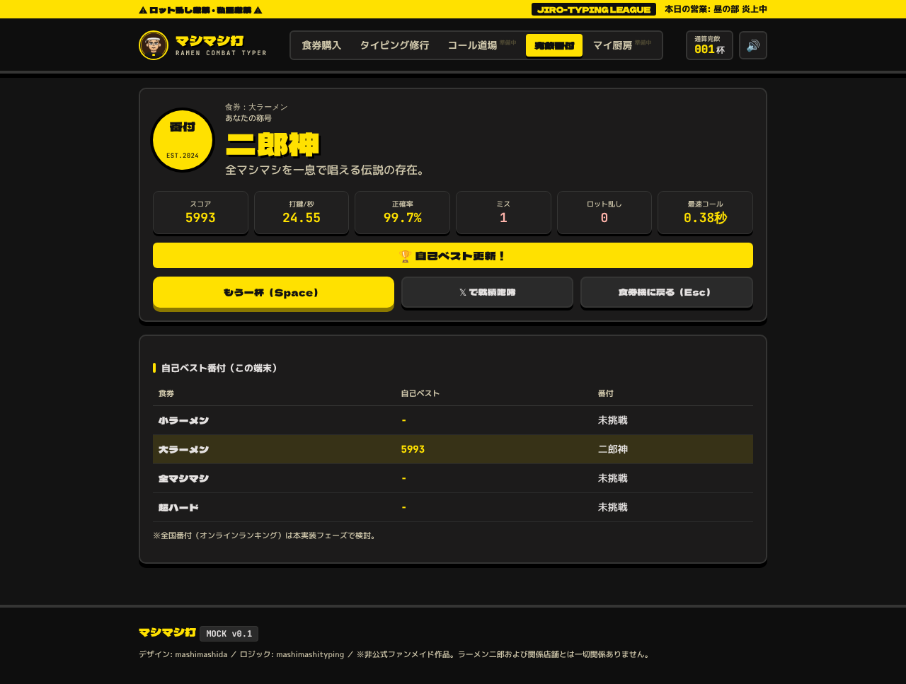
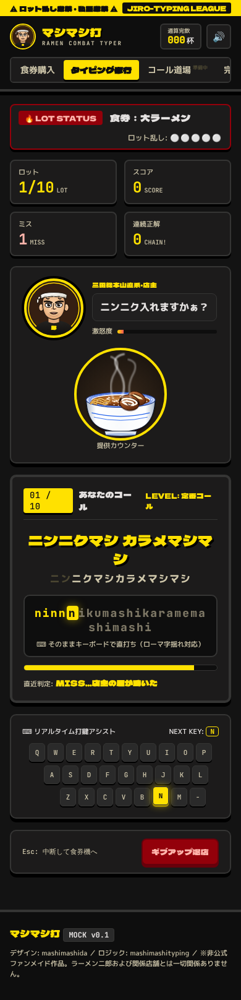

# 統合分析：mashimashida × mashimashityping

> 方針：**デザインは mashimashida、ロジックは mashimashityping** のいいとこどり

## 1. 両リポジトリの概要

| 項目 | mashimashida（マシマシ打） | mashimashityping（マシマシタイピング） |
|---|---|---|
| 技術 | React 19 + Vite 8 + TypeScript + Tailwind v4 + motion | 素の HTML / CSS / JS（ビルド不要） |
| 規模 | 約 4,200 行（コンポーネント 7 個） | 約 2,000 行（JS 4 ファイル） |
| 画面 | 食券購入 / タイピング修行 / コール道場 / 完飲番付 / マイ厨房 | タイトル（食券） / ゲーム / 結果 |
| 公開 | AI Studio 製（未公開） | GitHub Pages で公開済み |

## 2. mashimashida の強み（＝デザインとして採用）



- **デザイン言語が完成している**
  - 配色：背景 `#131313`、面 `#1c1b1b`、罫線 `#353534`、テキスト `#e5e2e1`、補助 `#cec6aa`
  - アクセント：二郎イエロー `#ffe100`（影 `#8b7800`）、警告レッド `#93000a` / `#68000b`、ピンク `#ffb4ab`
  - フォント：Dela Gothic One（見出し）／M PLUS 1p（本文）／JetBrains Mono（数値・ローマ字）
  - 影：`box-shadow: 0 4px 0 #000` の「ハードシャドウ」で押せる物理感
- **世界観を補強する UI パーツ**
  - 黄色の警告マーキー「ロット乱し厳禁・私語厳禁」
  - タブ型ナビ、通算完飲カウンター
  - 食券機（札の色で難易度：青札・黄札・赤札・黒札、価格表示）
  - 統計カード 4 連、店主アバター＋吹き出し＋激怒度、ローマ字ボックス、**仮想キーボードの NEXT KEY ハイライト**
  - 番付表（ランキング）、トロフィー、マイ厨房（プロフィール）
- **レスポンシブ**（モバイル用ナビあり）

### mashimashida の弱点（ロジック面）
- **ローマ字判定が 1 通りのみ**：`checkCharMatch` は大文字比較のみ。`shi/si`、`tsu/tu`、`n/nn` などの揺れに非対応
- 出題が**固定フレーズ 19 個**（`data/phrases.ts`）、コール道場もハードコードのローマ字
- ランキング・ユーザー統計の初期値が**ダミーデータ**（42 杯・412 WPM など）
- 画像（ロゴ・店主・丼）が **外部 URL（googleusercontent）直リンク** → 失効リスク
- 「WPM」計算が仮（`wpm * 5` で打鍵数を推定 等）

## 3. mashimashityping の強み（＝ロジックとして採用）



| モジュール | 内容 | 再利用性 |
|---|---|---|
| `js/romaji.js` | かな→複数ローマ字候補の判定エンジン（`shi/si/ci`、`tsu/tu`、`ん` の `n/nn/xn` 判定、`っ` の子音重ね/`ltu`、拗音） | ◎ DOM 非依存。そのまま TS 化可能 |
| `js/game.js`（前半） | コール生成（ヤサイ/ニンニク/アブラ/カラメ × スクナメ〜マシ×6・チョモランマ）、難易度別の重み・順不同、全マシ系スペシャル | ◎ 純粋関数化しやすい |
| 〃 `MultiTyper` | 複数の正解候補を同時追跡（超ハード：順不同・全マシ・ヤサイ省略を全部正解扱い） | ◎ |
| 〃 採点 | 打鍵数×係数＋残り時間ボーナス、打鍵/秒・正確率から称号 6 段階 | ◎ |
| `js/bowl.js` | コール内容（レベル 0〜9）から**丼を SVG で動的描画**（シード付き乱数） | ◎ 文字列を返すだけ |
| `js/master.js` | 店主の表情 SVG（normal / success / stern / wait） | ◎ |
| サウンド | WebAudio のオシレーターで効果音（素材ファイル不要） | ◎ |

## 4. 統合方針（提案）

### ベース：**mashimashida（React + Vite + TS）を土台にする**
理由：画面数・UI 部品が多く、デザイン側を作り直すより、ロジック側（DOM 非依存の純粋 JS）を移植する方がずっと小さい。

### 移植マップ

| mashimashida 側 | 置き換える／追加するロジック（mashimashityping） |
|---|---|
| `utils/romaji.ts`（1 通り判定） | `romaji.js` を TS 化して `utils/romaji.ts` に置換 |
| `data/phrases.ts`（固定 19 フレーズ） | `makeCall` / `makeSuperCall` / `answersFor` を `logic/calls.ts` に |
| `TicketVending`（sho/dai/buta/insane） | 難易度を easy/normal/hard/super に再マッピング（小/大/全マシマシ/超ハード）。トッピング小券（バフ）は後続で検討 |
| `TypingBattle`（写真・固定文） | ロット制ゲーム進行＋`Bowl` SVG＋`Master` 表情に置換。仮想キーボードの NEXT KEY は `typer.rest()[0]` で駆動 |
| `CallMaster`（コール道場） | `MultiTyper` で揺れ・順不同を許容。ビルダーで組んだコールを `lv` に変換して丼プレビュー |
| `Leaderboard`（ダミー） | 自己ベスト（localStorage）を表示。全国番付は将来のバックエンド次第 |
| 外部画像 | `Bowl` / `Master` の SVG に置換して外部依存をなくす |

### 公開
- 現状の mashimashityping は GitHub Pages（ビルド不要）。統合後は Vite ビルド → `dist/` を Pages へ（GitHub Actions）を想定。

## 5. モック（今回作成）

`mock/index.html` — **ビルド不要の静的モック**。実際に遊べます。

- デザイン：mashimashida のトークン・部品を CSS に移植（Tailwind 未使用で再現）
- ロジック：mashimashityping の `romaji.js` / `bowl.js` / `master.js` をそのまま、`game.js` のコール生成〜採点を `mock.js` に移植
- 画面：食券購入 → タイピング修行（カウントダウン・ロット制・仮想キーボード）→ 完飲番付（称号・自己ベスト）
- コール道場・マイ厨房は「準備中」表示（本実装で移植）

| 食券購入 | タイピング修行 |
|---|---|
|  |  |

| 超ハード | 結果・番付 | スマホ |
|---|---|---|
|  |  |  |

### 起動方法
```bash
cd mock && python3 -m http.server 8000
# → http://localhost:8000/
```

## 6. 決めたいこと（次フェーズ）

1. **ベースリポジトリ**：mashimashida（React）で進めてよいか／新リポジトリを作るか
2. **作品名**：「マシマシ打」か「マシマシタイピング」か
3. **トッピング小券（バフ）・激怒度・退店ペナルティ**など mashimashida 独自のゲーム要素を残すか
4. **完飲番付（全国ランキング）**：オンライン化するか、ローカル自己ベストのみにするか
