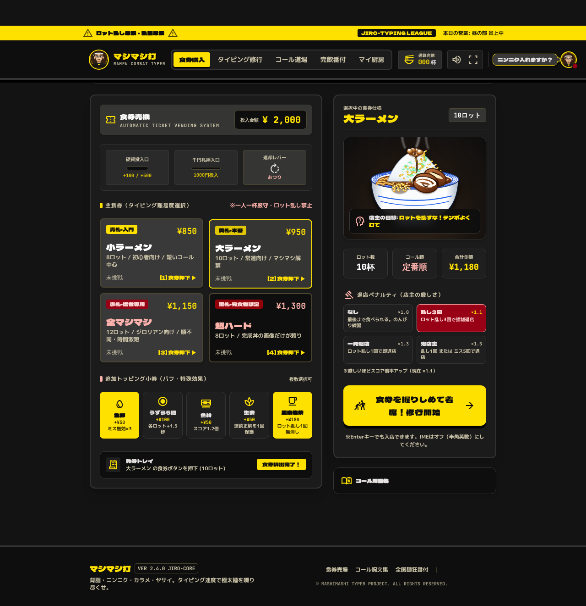
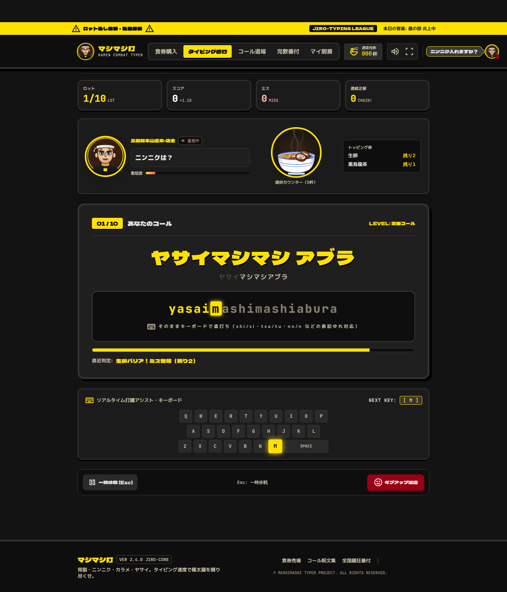
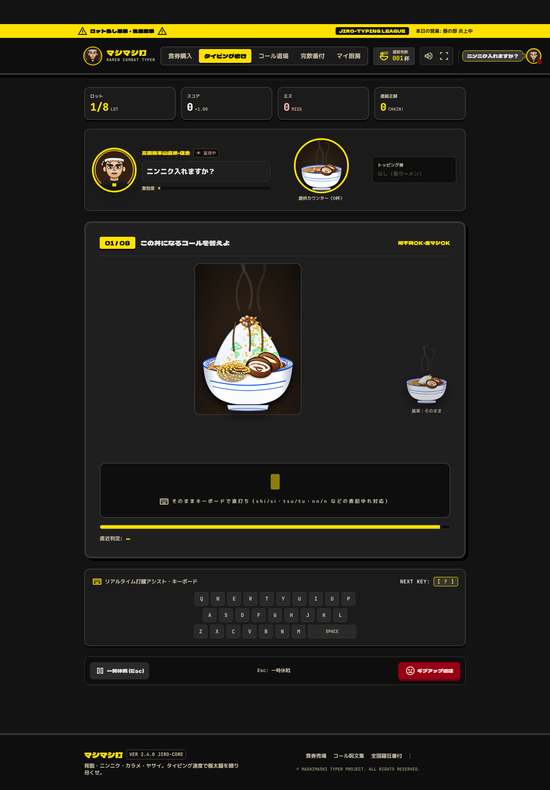
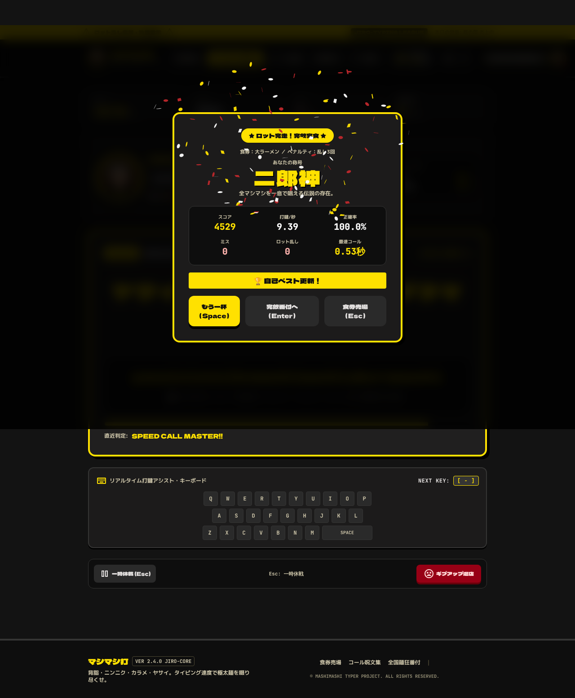
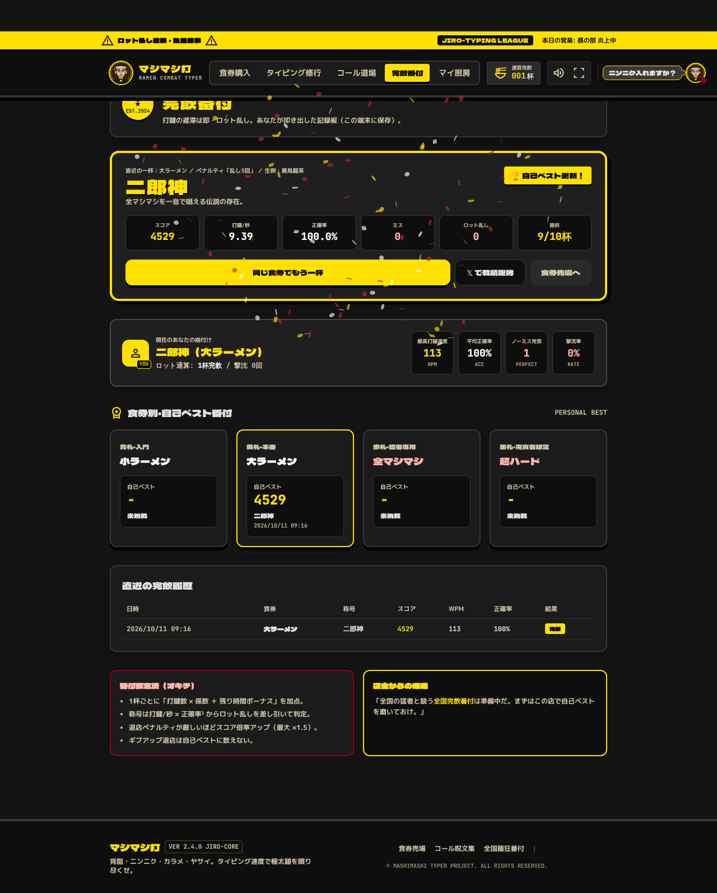

# 作業履歴

## 2026-10-11 統合の分析とモック作成

### 依頼
- mashimashida と mashimashityping をいいとこどりで組み合わせたい
- デザインは mashimashida、ロジックは mashimashityping
- まずは分析してモックを作成

### 作業内容
1. 両リポジトリを確認
   - mashimashida は当初 README のみ → ユーザーがコードを push（`b1f7650 chore: scaffold project structure`）
   - 作業ブランチ `claude/peaceful-shannon-j91m6m` を `origin/main` に fast-forward
2. mashimashida を `bun install` → Vite で起動し、全 5 画面をスクリーンショットで確認
   - `npm install` は esbuild の peer 依存衝突で失敗（`bun.lock` があるので bun を使用）
3. mashimashityping を静的サーバーで起動し、タイトル／ゲーム／超ハードを確認
4. コードを読み比べて分析 → [`docs/merge-analysis.md`](merge-analysis.md)
5. 静的モックを作成 → `mock/`
   - `mock/engine/` に mashimashityping の `romaji.js` / `bowl.js` / `master.js` をコピー
   - `mock/mock.js`：`game.js` のコール生成・`MultiTyper`・採点を移植し、新しい DOM に接続
   - `mock/mock.css`：mashimashida のデザイントークンをプレーン CSS で再現
6. Playwright で動作確認（PC 1280px / スマホ 390px）
   - 大ラーメンを最後まで自動プレイ → 結果画面・自己ベスト更新まで遷移することを確認
   - コンソールエラーなし、横スクロールなし
   - 超ハードの丼サイズ、ヘッダー・ロット番号の折返しを調整

### 成果物
- `docs/merge-analysis.md` … 分析と統合方針
- `docs/screenshots/` … 比較用スクリーンショット
- `mock/` … 遊べる統合モック

### 次のステップ（要確認）
- `docs/merge-analysis.md` の「6. 決めたいこと」を参照

---

## 2026-10-11 フェーズ1：コアゲームの統合

### 決定事項（ユーザー回答）
1. 土台はどちらでもよい → 画面・部品が揃っている **mashimashida（React + TS）** を土台に採用
2. 作品名は **マシマシ打**
3. トッピング券は残す。退店ペナルティは**ゲーム開始前に選択**
4. 段階的に実装。キーボード前提なのでスマホ対応は不要

### 作業内容
1. **エンジン移植**（`src/engine/`）
   - `romaji.ts`：`Typer` / `MultiTyper`（表記ゆれ・順不同対応）
   - `calls.ts`：4モードの設定、コール生成、超ハードの正解列挙
   - `scoring.ts`：ロット得点・称号判定
   - `bowl.ts` / `master.ts`：丼と店主の SVG 生成（`JiroArt.tsx` で表示）
2. **データ**：固定フレーズ・ダミー番付の `data/phrases.ts` を削除し、`data/shop.ts`（食券・トッピング券・退店ペナルティ）に置換
3. **食券購入**：4モードの食券、トッピング券（ロット制向けに効果を再定義）、退店ペナルティ選択、SVG 丼プレビュー、投入金額チェック、キー `1`〜`4` / `Enter`
4. **タイピング修行**：ロット制に全面書き換え
   - カウントダウン → コール表示 → 打鍵（NEXT KEY ハイライト）→ 丼提供 or ロット乱し
   - 一時休戦（Esc）、ギブアップ、強制退店、結果モーダル（Space / Enter / Esc）
   - タイマーバーは rAF で DOM 直接更新（毎フレーム再レンダリングしない）
5. **完飲番付 / マイ厨房**：ダミーデータを削除し実データ化（直近結果・食券別自己ベスト・履歴・トロフィー条件）
6. **外部画像の置換**：googleusercontent 直リンク画像を店主・丼 SVG に置換
7. **その他**
   - 未使用依存（@google/genai, express, dotenv, esbuild, tsx）を削除 → `npm install` の依存衝突も解消
   - 固定ヘッダーに上部が隠れる問題を修正
   - `tests/engine.test.ts`（bun test, 18件）を追加

### 検証
- `tsc --noEmit` / `vite build` 成功
- `bun test`：18 pass
- Playwright で E2E 確認（JS エラーなし）
  - 生卵でミス無効、黒烏龍茶でロット乱し帳消し
  - 大ラーメン完走 → 結果モーダル → 完飲番付・自己ベスト保存
  - 鬼店主でミス5回 → 強制退店
  - 超ハードで時間切れ時に正解表示、一時休戦モーダル

### スクリーンショット
| 食券購入 | タイピング修行 | 超ハード |
|---|---|---|
|  |  |  |

| 結果 | 完飲番付 |
|---|---|
|  |  |

### 次のステップ
- [ロードマップ](roadmap.md) のフェーズ2（コール道場の移植）

---

## 2026-10-11 丼・店主を写真デザインに戻す

### 依頼
- ラーメンのデザインが簡易的（SVG イラスト）になってしまっている。元のリアルなデザインにしたい、店主も

### 作業内容
1. AI Studio 版で使っていた写真3枚（丼・店主・ロゴ）を取得し、`src/assets/images/` に保存
   - 外部直リンク（期限切れリスク）だったものをリポジトリ内に取り込み、Vite でバンドル
   - 表示サイズに合わせて縮小（合計約 220KB）
2. `JiroArt.tsx` に `ChefPhoto` / `RamenPhoto` を追加し、元の配置に戻した
   - ヘッダー：ロゴ画像・店主アイコン
   - 食券購入：丼の写真プレビュー
   - タイピング修行：店主の写真（表情はリング色とアニメーションで表現：激怒＝赤リング＋脈動、正解＝黄色の発光＋うなずき）、提供カウンターの丼写真（調理中＝暗く、提供＝明るく跳ねる、ロット乱し＝白黒＋赤枠）と提供ゲージ
   - コール道場・マイ厨房：店主・丼の写真
3. 店主 SVG（`engine/master.ts`）は不要になったため削除
4. **超ハードの出題画像だけは SVG 丼のまま**（トッピング量 10 段階を描き分ける必要があり、写真1枚では表現できないため）

### 検証
- `tsc --noEmit` / `vite build` 成功、E2E（JS エラーなし）

---

## 2026-10-11 テストプレイ版の公開

- ビルド（相対パス）を Artifact として公開：https://claude.ai/artifact/Lf3wA2JLZjaA3hMt2UpLcy （非公開。オーナーのみ閲覧可）
- 公開前の確認で、`utils/audio.ts` が localStorage を例外処理なしで読んでおり、ストレージが使えない環境（プライベートモード等）でアプリが起動しない問題を発見 → try/catch で修正

---

## 2026-10-11 金額投入の削除・サウンド刷新

### 依頼
- 金額投入はゲームに邪魔なだけなので不要
- サウンドエフェクトがしょぼいので改善

### 作業内容
1. **食券購入から金額投入を削除**
   - 投入金額表示・硬貨/千円札投入口・返却レバー・残高不足チェックを削除（食券の価格表示は雰囲気として残す）
   - 「合計金額」の表示を、ゲームに意味のある **スコア倍率**（魚粉 × 退店ペナルティ）に置き換え
2. **サウンドを全面作り直し**（`utils/audio.ts`。音声ファイルは使わず Web Audio で合成）
   - 共通の音の流れ：コンプレッサーで音量を揃え、店内の響き（リバーブ）を追加
   - 場面ごとに専用の音を用意
     | 場面 | 音 |
     |---|---|
     | 打鍵 | メカニカルキーボードの「カチッ＋コトッ」（毎回少し揺らぎ） |
     | ミス | 濁った「ブッ」 |
     | 生卵バリア | 弾む「ぽよん」 |
     | 食券選択 / 発券 | 券売機の「ピッ」／印字「ジーッ」＋「ガシャン」 |
     | カウントダウン / 開始 | ベル＋太鼓／太鼓＋鐘「カーン」 |
     | 1杯提供 | 丼を置く「ドン」＋麺を啜る「ズズッ」＋チャイム（早打ちでキラキラ追加） |
     | 残り時間わずか | 拍子木「カッ」（終盤ほど速く） |
     | ロット乱し | 不協和の「ジャーン↓」＋低い太鼓 |
     | 完飲完食 | 太鼓2発＋金管ファンファーレ＋鐘 |
     | 強制退店 | 「ぶっぶー」＋下がるトロンボーン＋銅鑼 |
     | 一時休戦 | 下降2音 |
   - 旧 API 名（`playKeyStroke` など）は互換用に残し、コール道場はそのまま動く

### 検証
- 全14音を OfflineAudioContext で描画して計測：エラーなし、クリップなし（最大ピーク 0.73）。小さすぎた打鍵・ミス・拍子木の音量を調整
- `tsc` / `bun test`（18 pass）/ E2E（JS エラーなし）

---

## 2026-10-11 ルール説明画面・魚粉の廃止・画像差分の可否調査

### 依頼
1. お題に合わせてラーメン画像を変化させたい（理想）
2. 食券選択に合わせてラーメン画像を変えたい。全部リアルな画像の差分にしたいが、**変更前に可能かどうかを知りたい**
3. タイピング修行・コール道場はいきなり始めず、ルール説明 → 開始ボタンで開始
4. トッピングの必要性が微妙。無条件スコア1.2倍は絶対なし

### 作業内容
- **ルール説明画面**（`components/RuleIntro.tsx` を共通部品として新設）
  - タイピング修行：遊び方（通常／超ハードで内容を出し分け）、今回の条件（ロット数・コール順・退店ペナルティ・トッピング券・操作）。Enter / Space で開始、Esc で食券売場へ。結果画面の「もう一杯」は説明を飛ばして即開始
  - コール道場：開くと即タイマーが動き 3.5 秒で失敗していた問題も解消。判定が表示どおりの綴りのみである旨を明記
  - 前画面の Enter で即開始しないよう、キー受付を 150ms 遅らせる
- **魚粉（無条件スコア1.2倍）を廃止**。スコア倍率は退店ペナルティだけで決まるように変更。保存済み設定に魚粉が残っていても無視
- 1・2（画像差分）は**実装せず可否のみ回答**（下記）

### 画像差分の可否（回答内容の要約）
- 食券ごとの写真4枚：可能。ベース写真から AI 画像編集で差分を作るのが確実
- お題ごとの写真：全組み合わせ（約1万通り）の事前生成は不可能。ベース写真＋トッピング別の透過レイヤーを重ねる「レイヤー合成」なら可能性あり（要試作）
- この作業環境には画像生成機能がないため、写真の生成は AI Studio 等で行うか、API キーの提供が必要

### 検証
- `tsc` / E2E（説明画面 → 開始の流れ、JS エラーなし）
- コール道場：説明画面の間はタイマーが動かず、開始後に入力欄へフォーカスされることを確認

---

## 2026-10-11 トッピング廃止・開始ボタン・ロゴ・コンプライアンス・食券別写真

### 依頼
- トッピング自体を消してよい
- ゲーム開始は画面を開いてすぐに見える位置にしたい
- タイトルのアイコンが「マシマシ打ち」になっていて間違っている（正しくはマシマシ打）
- 「二郎直系」の表記はやめる
- コンプライアンスのチェック
- ラーメン画像は①（食券ごと）でまず見せる。②（お題ごと）は没ではないので、あとで再検討できるよう控えておく

### 作業内容
1. **トッピング券を全削除**：データ・型・食券購入・修行（バフ処理と表示）・ルール説明・番付・README から削除。修行画面の券の欄は「退店ペナルティの状況（ロット乱し・ミス・倍率）」に置き換え。旧バージョンの保存設定は必要な項目だけ読み込む
2. **開始ボタンをファーストビューへ**
   - 食券購入：ページ最上部に「開始バー」（選択中の食券写真・食券名・ロット数・退店ペナルティ・倍率＋開始ボタン）
   - ルール説明（修行・道場）：開始ボタンを店主の前置きの直下へ移動
   - 1280×720 で開始ボタンがスクロールなしで見えることを確認
3. **ロゴ**：「マシマシ打ち」と焼き込まれた画像を削除し、文字を SVG で描くエンブレム（`components/Logo.tsx`）に差し替え。ファビコンも「打」の SVG に
4. **コンプライアンス**：[compliance.md](compliance.md) に結果を記録
   - 「二郎」「ジロリアン」「三田総本山」「JIRO」表記を画面・メタ情報・README から削除（称号名も変更し、保存済みの旧称号は自動変換）
   - 存在しない機能の表示（全国番付へ送信など）・計測していない固定値（FPS/LATENCY）を削除
   - 音声認識（音声の外部送信を説明なく行い、何を話しても正解になる）を削除
   - フッターに非公式・無関係の免責と「写真は AI 生成画像」の表示を追加
   - 未使用ライブラリ（lucide-react / motion）を削除、ライセンスを確認
5. **① 食券ごとのラーメン写真**：元写真のヤサイの山だけを縦に伸縮させて4枚を作成（`scripts/make_ticket_photos.py`）。食券を選ぶと開始バーとプレビューの写真が切り替わる
6. **② は保留として記録**：[image-variants.md](image-variants.md)（レイヤー合成案・素材の段階・リスク・再開手順）

### 検証
- `tsc` / `bun test` / E2E（JS エラーなし）
- ファーストビューの開始ボタン位置を計測（食券購入 146〜202px、ルール説明 316〜376px／高さ720px）

---

## 2026-10-11 タイピング修行のポップアップ化・プレイ画面の簡素化

### 依頼
- タイピング修行はタブではなくポップアップにしたい（食券購入で設定を選んで修行、という流れのため）
- プレイを始めたときに肝心のタイピング文字が全部映らないのはダメ。寿司打・e-typing のようにシンプルな画面にして、情報量を減らし、しっかり見えるようにしたい

### 作業内容
1. **ポップアップ化**
   - ヘッダー（PC・スマホ）から「タイピング修行」タブを削除
   - 食券購入で `Enter`／開始ボタン → ポップアップでルール説明 → プレイ → 結果。閉じる（Esc）と食券購入に戻る。結果から「完飲番付へ」で番付画面へ
   - 完飲番付の「同じ食券でもう一杯」もポップアップで開く
   - ポップアップ表示中は背面の食券購入のキー操作（1〜4・Enter）を無効化し、背面のスクロールも止める
2. **プレイ画面の簡素化**
   - 上段：食券名・ロット・スコア・ミス・乱し・一時休戦・ギブアップを1行に集約
   - 店内：店主（小）・吹き出し・提供カウンター（小）の1行だけ。激怒度バー・提供ゲージの文字・トッピング欄・操作バーを削除
   - 主役：コール・かな・ローマ字・持ち時間バーを大きく表示
   - キーボード：キーを小さくし、超ハードでは非表示（答えを伏せるため光らない）
   - カウントダウン・一時休戦・結果はポップアップ内に重ねて表示
3. **ルール説明**：大きな写真の見出しをやめて小型化（コール道場も共通）

### 検証
- 1280×720 / 1600×900 / 1366×650 で、コール・かな・ローマ字の枠がスクロールなしで全て見えることを計測（ポップアップ内のはみ出し 0）
- E2E（完走・強制退店・超ハード・一時休戦、JS エラーなし）

---

## 2026-10-11 キーボード廃止・超ハードをオフ・プレイヤーの定義

### 依頼
- ゲーム中にキーボードは表示しない。なくした分は情報があってもよい
- 超ハードは一旦オフ
- トップ右上の画像は店主なのか自分（プレイヤー）なのか不明。自分ならアイコンを自分で設定できるとよい。難しければ店主とは違うとわかるようにしたい（店主が修行しているの？客？）

### 作業内容
1. **キーボード廃止**：仮想キーボード（`VirtualKeyboard.tsx`）を削除。代わりにプレイ中の情報を1行で表示（残り時間〔秒・終盤は赤〕／連続正解／正確率／打鍵/秒／提供杯数）。店主の写真の下に「店主」ラベルを追加
2. **超ハードをオフ**：`data/shop.ts` の `MODE_ORDER` から除外（コードは残し、`'super'` を足せば復活）。キー `4` は無効、保存設定が超ハードなら小ラーメンに戻す。番付の食券別ベスト・常連カードのトロフィーからも非表示。食券は3枚になったので横長の1列表示に変更
3. **登場人物の定義**：**プレイヤー＝お店に通う常連客**、**店主＝お店の人（写真）**
   - ヘッダー右上：店主の写真＋「ニンニク入れますか？」吹き出しをやめ、プレイヤーのアイコン（ピンクの枠＋「YOU」）と「あなた（常連客）／名前」を表示
   - 「マイ厨房」→「**常連カード**」（画面・タブ名・ルート名）。「認定門下生」「厨房から出陣」も客向けの表現に変更
   - 常連カードで名前（16文字まで）とアイコンを変更可能：プリセット8種（絵文字）または画像アップロード（中央を正方形に切り抜いて 128px の JPEG に縮小し、この端末の localStorage にだけ保存。画像以外・10MB 超はエラー表示）
   - 完飲番付の「YOU」カードもプレイヤーのアイコンと名前に

### 検証
- `tsc` / `bun test` / E2E（JS エラーなし、食券3枚・キー4無効・プレイ中の情報表示を確認）
- アイコン：プリセット選択・名前変更がヘッダーに反映、画像アップロードで約9KBのデータとして保存、テキストファイルはエラー表示
- 1280×720 / 1600×900 / 1366×650 でポップアップ内のはみ出し 0

---

## 2026-10-11 コール道場の削除

### 依頼
- コール道場は時間制限に無理がある。必要性もよくわからないので消してもいいのでは？（理由があれば教えて）→ 削除の方針で合意

### 判断理由（回答の要約）
- 制限時間がコールの長さに関係なく 3.5 秒固定。約45打のコールだと毎秒13打が必要で、上級者でもほぼ不可能
- 「表示されたコールを打つ」という中身は修行とほぼ同じで、違いは自分でコールを組める点だけ
- 判定が1通りの綴りのみ・記録が番付に残らない・見本の固定値が表示される、と作りかけの部分が多い
- 「自分のコールを練習したい」は、将来「自分のコールで練習」食券として修行の仕組みで実現できる

### 作業内容
- `components/CallMaster.tsx` を削除。ヘッダー（PC・スマホ）・フッターのリンク、画面の種類（ScreenType）から除外
- 常連カードの「道場で練習」ボタンを削除（マイ・デフォルトコールはプロフィールとして残す）
- 道場専用だった旧サウンド API 名（`playKeyStroke` など）を削除
- README・ロードマップ・コンプライアンス表（項目G を解消済みに）を更新

### 検証
- `tsc` / `bun test` / E2E（JS エラーなし）

---

## 2026-10-11 公開の準備

### 依頼
- 「公開の準備」を進める

### 調査結果
- `shinpoyo/mashimashida` は**非公開リポジトリ**。無料プランでは非公開リポジトリを GitHub Pages で公開できない
- `main` へのプルリクエストはまだない（作業は全て `claude/peaceful-shannon-j91m6m` ブランチ）

### 作業内容（公開先に依存しない準備）
1. **ビルド設定**：`vite.config.ts` を `base: './'`（相対パス）に。`__dirname` を `import.meta.dirname` に置き換え（Vite の警告解消）
2. **共有カード（OGP）**：`public/ogp.jpg`（1200×630、店の写真＋ロゴ＋「ニンニク入れますか？」）を作成。ビルド時の環境変数 `SITE_URL` で `og:url` / `og:image` / `twitter:image` を出力し、未指定なら出力しない
3. **CI**：`.github/workflows/ci.yml`（型チェック・テスト・ビルド）
4. **Pages デプロイ**：`.github/workflows/deploy-pages.yml`（`main` へのプッシュで公開。公開 URL を `SITE_URL` に自動設定）
5. **手順書**：[publishing.md](publishing.md)（公開先の選択肢 A〜D と手順、公開前に決めること）

### 検証
- `bun install --frozen-lockfile`（CI と同じ条件）・`tsc`・ビルド成功
- `SITE_URL` 指定時のみ OGP タグが入ることを確認
- `/mashimashida/` のサブパスで配信してプレイ開始まで動作（画像読み込み・JS エラーなし）

### 決定事項（ユーザー回答）
- 公開先：リポジトリを公開して GitHub Pages
- ライセンス：権利保持（無断利用不可）
- 作業ブランチ → main のプルリクエストを作成
- AI Studio 由来のファイル（metadata.json / .env.example）を削除

### 追加作業
- `LICENSE`：All rights reserved（日英）＋第三者表記（AI Studio テンプレート・React・canvas-confetti・開発ツール・フォント・AI 生成画像）
- フッター・README に権利表記を追加
- 公開に先立ち全履歴を確認：機密情報なし、コミットのメールは noreply のみ
- 「ラーメン二郎」表記が残る統合前のモック `mock/` を削除（Git 履歴から復元可能）
- CI 初回実行：成功（型チェック・テスト・ビルド）
- [publishing.md](publishing.md) にオーナー作業（マージ → 公開設定 → Pages 有効化 → 初回デプロイ）を記載

---

## 2026-10-11 公開完了・独自ドメインの調査

### 依頼
- PR をマージした。ドメイン取得について教えてほしい

### 確認
- 「Deploy to GitHub Pages」成功。https://shinpoyo.github.io/mashimashida/ が 200 を返し、og:image も公開 URL で出力されている
- 公開サイトをブラウザで開き、食券購入 → ルール説明 → プレイ開始まで動作（JS エラー・読み込み失敗なし）

### 作業内容
- [custom-domain.md](custom-domain.md) を作成：ドメイン名の候補と空き状況（RDAP で確認）、登録業者の比較、GitHub Pages への設定手順（所有確認・DNS・Custom domain・HTTPS）、アプリ側は変更不要であること
- README にプレイ URL、publishing.md・roadmap に公開済みを反映
- 作業ブランチは PR #1 マージ後の main から作り直した

---

## 2026-10-11 shinpoyo.com 取得・2要素認証の案内

- ユーザーが Cloudflare Registrar で **shinpoyo.com** を取得（RDAP で登録・期限 2027-10-11・Cloudflare ネームサーバーを確認。DNS レコードはまだなし）
- Cloudflare の2要素認証の場所を案内（My Profile → Authentication）。公式ドキュメントで手順を確認
- shinpoyo.com の使い方として「A. 個人サイト化（shinpoyo.com/各プロジェクト/）」「B. ゲームごとのサブドメイン」を整理し、[custom-domain.md](custom-domain.md) に追記

---

## 2026-10-11 案 A（個人サイト化）に着手

- 方針決定：shinpoyo.com を個人サイトにし、各プロジェクトを `shinpoyo.com/<リポジトリ名>/` で配信
- 個人サイト（`shinpoyo.github.io` リポジトリ）の中身を用意：作品一覧のトップページ・404・README・設定手順・作業履歴
  - 一覧：マシマシ打・けしカス・もぐもぐカメラ。旧版 mashimashityping は「ラーメン二郎」表記が残るため載せない
  - PC・スマホ幅で表示確認（横スクロールなし）
- GitHub 上のリポジトリ作成は権限不足（403）でできなかったため、ユーザーに空リポジトリの作成を依頼。作成後に push する
- [custom-domain.md](custom-domain.md) に決定事項と DNS の値を追記

---

## 2026-10-11 独自ドメイン shinpoyo.com へ移行

- ユーザーが `shinpoyo/shinpoyo.github.io` を作成 → 個人サイトを push（詳細はそちらの `docs/worklog.md`）
- ユーザーが Cloudflare DNS（所有確認 TXT・A×4・AAAA×4・CNAME www）、Custom domain、Enforce HTTPS を設定
- 確認（DoH・curl）：
  - DNS は A / AAAA / CNAME とも正しい値
  - `https://shinpoyo.com/`・`/mashimashida/`・`/keshikasu/`・`/mogumogu-camera/`・`/smudge-privacy/` すべて 200（証明書も有効）
  - `https://www.shinpoyo.com/` → `https://shinpoyo.com/`、`https://shinpoyo.github.io/mashimashida/` → `https://shinpoyo.com/mashimashida/` に 301 転送
- 「Deploy to GitHub Pages」を手動実行 → OGP の URL が `http://shinpoyo.com/...`（http）になった
  - 原因：`configure-pages` の `base_url` が http を返した（HTTPS 強制が反映される前のため）
  - 対応：workflow で `https://` に揃えてから `SITE_URL` に渡すよう修正（main に入ったら再デプロイで直る）
- README・publishing.md・custom-domain.md・roadmap のプレイ URL を `https://shinpoyo.com/mashimashida/` に更新
- PR #2 マージ → 自動デプロイで OGP（`og:url`・`og:image`・`twitter:image`）が `https://shinpoyo.com/mashimashida/` になったことを確認。`ogp.jpg` も 200
